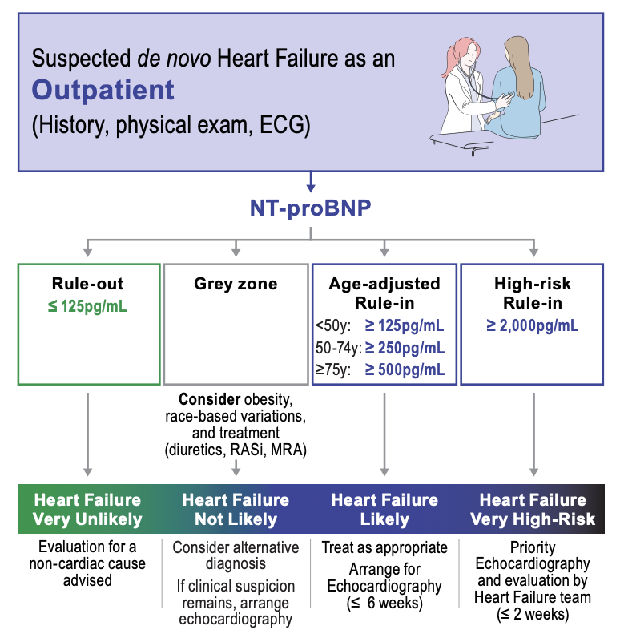
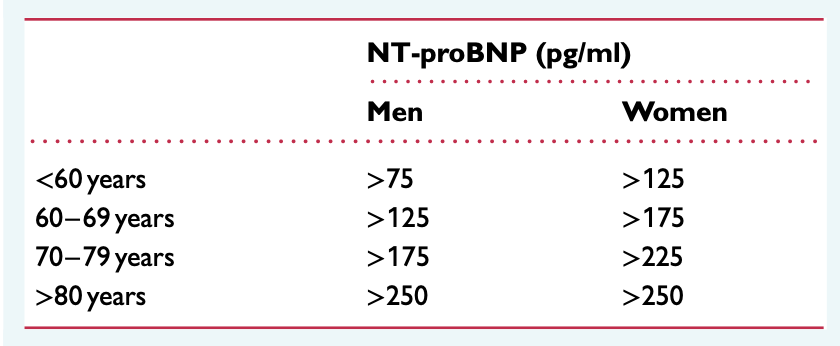

# DocVision

<p align="center">
  
  
  
</p>

<p align="center">
  <strong>Extract structured, machine-readable text from complex PDFs using vision language models.</strong>
</p>

A versatile CLI tool for any domain or project that needs to turn complex PDFs into rich, structured text—preserving tables, describing diagrams, and capturing visual context that traditional OCR misses entirely. Originally built to prepare dense clinical guidelines and multi-format HR documents for downstream AI agents, it excels anywhere "good enough" text extraction simply isn't good enough.

- **Provider-agnostic** — supports OpenAI, Azure OpenAI, and any OpenAI-compatible endpoint
- **Structure-aware** — turns tables into Markdown, flowcharts into decision trees, and figures into text descriptions
- **Resilient batching** — handles hundreds of PDFs with progress bars, ETAs, and checkpointed resume
- **Handwriting & scans** — natively extracts handwritten notes, stamps, and scanned pages
- **Auto-orientation** — detects and corrects sideways or upside-down pages before extraction
- **Zero configuration** — no fine-tuning, OCR engine tuning, or language packs needed

---

## Table of Contents

- [Why This Exists](#why-this-exists)
- [Vision OCR vs. Classical OCR](#vision-ocr-vs-classical-ocr)
- [Choosing a Vision Model](#choosing-a-vision-model)
- [What Gets Extracted](#what-gets-extracted)
- [Getting Started](#getting-started)
- [Usage](#usage)
- [Configuration](#configuration)
- [How It Works](#how-it-works)
- [Handling Rotated Pages](#handling-rotated-pages)
- [Building a Knowledge Base](#building-a-knowledge-base)
- [Limitations](#limitations)
- [Troubleshooting](#troubleshooting)
- [References](#references)

---

## Why This Exists

This tool was built out of a specific need: extracting text from complex, real-world PDFs
that classical OCR tools handle poorly. The documents that prompted it were clinical
guidelines with hundreds of pages each and HR personnel files
(contracts, certificates, scanned letters, handwritten notes). These aren't clean,
single-column journal articles. They contain:

- **Nested tables** with merged cells and multi-level headers
- **Clinical decision flowcharts** where the spatial layout *is* the information
- **Forest plots** and statistical figures that summarize trial outcomes
- **Graded recommendation panels** with Class/Level-of-Evidence systems
- **Scanned pages** with stamps, signatures, and handwritten annotations
- **Mixed layouts** — two-column text, sidebars, footnotes, captions

Traditional OCR extracts the characters. But characters without structure are noise.
A table that becomes a jumbled paragraph has *lost* information — an LLM reading it
can't reconstruct which value belongs to which column. A flowchart that becomes a
flat word list has lost the decision logic that makes it useful.

The goal of this tool isn't just to extract text. It's to produce output that a
downstream system — an LLM, a search index, a RAG pipeline — can actually reason over.

<div align="right"><b><a href="#table-of-contents">back to top</a></b></div>

---

## Vision OCR vs. Classical OCR

Classical OCR (Tesseract, PaddleOCR, AWS Textract) works bottom-up: detect text regions,
segment characters, classify each glyph, assemble into words. It's a pattern-matching
pipeline that operates at the pixel level.<sup><a href="#footnote1">[1]</a></sup>

Vision OCR flips this entirely. Instead of building text from pixels, it *understands the
page as a whole* — the same way a human reader does.

```
┌──────────────────────────────────────────────────────────────────┐
│                      Classical OCR Pipeline                      │
│                                                                  │
│  Image → Binarize → Detect regions → Segment chars → Classify    │
│    → Assemble words → Output text                                │
│                                                                  │
│  ✗ No understanding of what a "table" or "flowchart" is          │
│  ✗ Each character is an independent classification problem       │
│  ✗ Layout is inferred from coordinates, often incorrectly        │
│  ✗ Handwriting requires specialized models per script            │
└──────────────────────────────────────────────────────────────────┘

┌──────────────────────────────────────────────────────────────────┐
│                      Vision OCR (this tool)                      │
│                                                                  │
│  Image → Vision LLM (sees entire page at once) → Structured text │
│                                                                  │
│  ✓ Understands tables, diagrams, charts as semantic objects      │
│  ✓ Reads handwriting, stamps, mixed fonts in one pass            │
│  ✓ Preserves relationships ("this value belongs to that column") │
│  ✓ Can describe what a figure *means*, not just its labels       │
└──────────────────────────────────────────────────────────────────┘
```

The key insight: a vision language model (VLM) like GPT-4o doesn't just *read* the page — it
*comprehends* it. When it sees a table, it understands the relationship between headers
and cells. When it sees a flowchart, it understands the decision logic. This comprehension
is what makes the extracted text useful for downstream processing.

**The tradeoff is cost and speed.** Classical OCR is essentially free and processes pages
in milliseconds. Vision OCR costs roughly $0.01–0.03 per page and takes 10–20 seconds each.
For a 300-page guideline, that's ~$6 and ~90 minutes. But the output quality is
incomparably higher — and for building a knowledge base you query repeatedly, extraction
is a one-time cost.

| Dimension | Classical OCR | Vision OCR |
|:----------|:---:|:---:|
| Raw text accuracy | ★★★★☆ (printed) / ★★☆☆☆ (scans) | ★★★★★ |
| Table structure | ★★☆☆☆ | ★★★★★ |
| Diagram understanding | ☆☆☆☆☆ | ★★★★☆ |
| Handwriting | ★★☆☆☆ (requires config) | ★★★★☆ |
| Speed | ★★★★★ (~50ms/page) | ★★☆☆☆ (~15s/page) |
| Cost per page | Free | ~$0.01–0.03 |
| Setup complexity | High (engines, language packs) | None (API key only) |

<div align="right"><b><a href="#table-of-contents">back to top</a></b></div>

---

## Choosing a Vision Model

Not all vision models are created equal for document extraction — and the most powerful
model isn't necessarily the best choice. This section explains why.

### Why GPT-4o is the default

GPT-4o hits the sweet spot for this task: strong vision comprehension, fast response times,
and the lowest cost per page among frontier models. Document OCR is a *perception* task
more than a *reasoning* task — the model needs to accurately read what's on the page, not
solve a novel problem. That means the extra reasoning capacity of more powerful models goes
largely unused.

### The model landscape for document extraction

| Model | Vision | OCR quality | Speed | Cost/page | Best for |
|:------|:------:|:-----------:|:-----:|:---------:|:---------|
| **GPT-4o** | ✓ | ★★★★★ | ~15s | ~$0.01 | **Default choice** — best quality-to-cost ratio |
| **GPT-4o mini** | ✓ | ★★★★☆ | ~5s | ~$0.003 | Large batches where speed/cost matter more than perfect accuracy |
| **Claude Opus** | ✓ | ★★★★★ | ~25s | ~$0.05 | Overkill — superb reasoning, but OCR doesn't need it |
| **Claude Sonnet** | ✓ | ★★★★☆ | ~15s | ~$0.01 | Good alternative to GPT-4o |
| **Gemini 2.5 Pro** | ✓ | ★★★★☆ | ~10s | ~$0.01 | Fast, competitive quality |
| **Gemini 2.5 Flash** | ✓ | ★★★☆☆ | ~4s | ~$0.002 | Budget option for clean printed PDFs |

### Why frontier reasoning models are overkill

Models like Claude Opus, o3, or GPT-4.5 are designed for complex multi-step reasoning —
writing code, solving math problems, crafting nuanced arguments. They're significantly
more expensive ($0.03–0.08 per page) and slower. For document extraction, that extra
reasoning capacity buys you almost nothing:

- **Reading a table** requires accurate perception, not chain-of-thought reasoning
- **Transcribing text** is pattern matching, not problem solving
- **Describing a flowchart** needs spatial understanding, which GPT-4o already handles well

The one exception: if your documents contain highly ambiguous content (degraded
handwriting, faded ink, overlapping stamps) where the model needs to *infer* what a
character might be from context, a stronger model may produce marginally better results.
But for 95% of document extraction work, GPT-4o is the right tool.

### What about local and open-source alternatives?

The document extraction landscape has evolved significantly. Beyond classical OCR engines
(Tesseract, EasyOCR), there are now open-source vision-language models specifically built
for document understanding. Here's the honest picture:

**Classical OCR engines** — Tesseract, PaddleOCR (base), EasyOCR:

```
  ✓ Free, runs locally, fast (~50ms/page)
  ✗ Text only — no semantic understanding of tables, diagrams, or figures
  ✗ Language packs and config tuning required
  ✗ Handwriting needs specialized models per script
```

These are fundamentally character-recognition pipelines. They read glyphs, not pages.

**Document-specialized VLMs** — a newer category that combines vision models with
document-specific training:

| Model | Size | License | Strengths |
|:------|:-----|:--------|:----------|
| **PaddleOCR-VL 1.6**<sup><a href="#footnote4">[4]</a></sup> | ~0.9B | Apache 2.0 | Tables, formulas, charts, stamps/seals, skewed scans; runs on laptop |
| **GOT-OCR 2.0**<sup><a href="#footnote5">[5]</a></sup> | ~0.6B | Apache 2.0 | End-to-end document understanding; sheet music, molecular formulas |
| **Nougat**<sup><a href="#footnote6">[6]</a></sup> | ~0.3B | MIT | Academic papers → structured markdown; excellent on LaTeX-heavy content |
| **Florence-2**<sup><a href="#footnote7">[7]</a></sup> | ~0.7B | MIT | General vision tasks including OCR; Microsoft Research |

These are real, capable tools. PaddleOCR-VL in particular handles tables, stamps, and
skewed scans well — and it's completely free. So why doesn't DocVision use them?

### Why DocVision uses cloud VLMs anyway

The short answer: **structured descriptions require reasoning, not just perception.**

DocVision's key feature isn't raw text extraction — for that, PaddleOCR-VL or GOT-OCR
would be perfectly adequate. The differentiator is the `[DIAGRAM]`, `[TABLE]`,
`[RECOMMENDATION]`, and `[FIGURE]` annotations that make the output *useful to downstream
LLMs and search systems*.

Consider what happens when the model encounters a clinical decision flowchart<sup><a href="#footnote8">[8]</a></sup>:

<p align="center">
  
</p>

```
  PaddleOCR-VL (0.9B)                     GPT-4o (~200B+)
  ────────────────────                     ─────────────────
  Reads text in each box:                  Understands the decision logic:
                                           
  "Rule-out"                               "This is a diagnostic flowchart.
  "≤ 125pg/mL"                             NT-proBNP ≤ 125pg/mL rules out
  "Heart Failure Very Unlikely"            heart failure. Values between
  "Grey zone"                              125 and the age-adjusted threshold
  "Age-adjusted Rule-in"                   are a grey zone. Above the threshold,
  ...                                      heart failure is likely, and the
                                           patient should receive echo within
                                           6 weeks..."
```

A 0.9B model can *read* the boxes. A frontier model can *explain* what the flowchart
*means* — the relationships between nodes, the decision logic, and the clinical
implications. That explanation is what makes the extracted text useful for RAG systems,
clinical Q&A, and knowledge bases.

The same applies to tables: PaddleOCR-VL can detect table cells, but flattening nested
multi-level headers into self-contained column names (e.g., "NT-proBNP Men (pg/mL)")
requires understanding what the header hierarchy *means* — a reasoning task that small
models handle inconsistently.

### When to use what

| Use case | Best tool | Why |
|:---------|:----------|:----|
| Bulk text extraction (invoices, receipts, forms) | PaddleOCR-VL / GOT-OCR | Free, fast, accuracy is sufficient |
| Offline / air-gapped environments | PaddleOCR-VL | No internet needed |
| Academic papers → structured text | Nougat | Purpose-built, excellent on LaTeX |
| Complex documents needing semantic understanding | **DocVision (GPT-4o)** | Only frontier VLMs produce the structured descriptions |
| Budget-sensitive large batches | GPT-4o mini or Gemini Flash | Cloud quality at reduced cost |
| Maximum extraction quality | **DocVision (GPT-4o)** | Best general-purpose document comprehension |

**Bottom line:** Local document VLMs are excellent for *reading*. Cloud frontier VLMs are
necessary for *understanding*. DocVision targets the latter — when the extracted text needs
to be rich enough for an LLM to reason over, not just searchable. If all you need is the
raw text, PaddleOCR-VL is the smarter (and free) choice.

### Switching models

```bash
# Use GPT-4o mini for a large batch (3x cheaper, 3x faster)
python extract.py --model gpt-4o-mini large-batch/*.pdf

# Use Claude Sonnet via a compatible proxy
python extract.py --api-base https://my-proxy.com/v1 --model claude-sonnet-4-20250514 docs/*.pdf

# Use Gemini via a compatible gateway
python extract.py --api-base https://my-gateway.com/v1 --model gemini-2.5-flash docs/*.pdf
```

<div align="right"><b><a href="#table-of-contents">back to top</a></b></div>

---

## What Gets Extracted

Every page produces verbatim text plus structured annotations for visual elements:

| Element | Tag | Output |
|:--------|:----|:-------|
| Plain text | *(none)* | Verbatim transcription preserving layout |
| Tables | `[TABLE]` | Markdown table with flattened, self-contained column headers |
| Flowcharts / decision trees | `[DIAGRAM]` | Structured description of nodes, connections, and logic |
| Statistical figures | `[FIGURE]` | Description of comparisons, effect direction, key numbers |
| Recommendation panels | `[RECOMMENDATION]` | Recommendation text with class and level of evidence |
| Redacted areas | `[REDACTED]` | Inline marker where content was blacked out |

**Example — a nested table becomes unambiguous markdown:**

<p align="center">
  
  <br><span>Table 1 from Bayes-Genis et al. (2023)<sup><a href="#footnote8">[8]</a></sup> — age- and sex-adjusted NT-proBNP thresholds with nested column headers.</span>
</p>

*DocVision's extracted output:*
```markdown
[TABLE]
| Age group   | NT-proBNP Men (pg/mL) | NT-proBNP Women (pg/mL) |
|-------------|------------------------|--------------------------|
| <60 years   | >75                    | >125                     |
| 60–69 years | >125                   | >175                     |
| 70–79 years | >175                   | >225                     |
| >80 years   | >250                   | >250                     |
```

The nested "Men" / "Women" sub-headers under "NT-proBNP (pg/mL)" are flattened into
self-contained column names — every cell value is unambiguously tied to its row and column.
This is **real output**, not a handcrafted example.

For a flowchart extraction example (`[DIAGRAM]`), see the [model comparison above](#why-docvision-uses-cloud-vlms-anyway).

<div align="right"><b><a href="#table-of-contents">back to top</a></b></div>

---

## Getting Started

### Prerequisites

- **Python 3.9+**
- An API key for any OpenAI-compatible vision endpoint

### 1. Clone and install

```bash
git clone https://github.com/alx-sch/pdf-vision-ocr.git
cd pdf-vision-ocr
pip install -r requirements.txt
```

### 2. Configure

```bash
cp .env.example .env
```

Edit `.env` with your API key and (optionally) endpoint and model:

```bash
# Required
OPENAI_API_KEY=sk-...

# Optional — defaults shown
OPENAI_API_BASE=https://api.openai.com/v1
OPENAI_MODEL=gpt-4o
```

The tool loads `.env` automatically via `python-dotenv`. Alternatively, pass
`--api-key`, `--api-base`, and `--model` as CLI flags.

### 3. Extract

```bash
# Single file
python extract.py document.pdf

# Entire folder
python extract.py papers/*.pdf

# Custom output directory
python extract.py -o results/ documents/*.pdf
```

That's it. Output lands in `<input-dir>/extracted/` by default.

<div align="right"><b><a href="#table-of-contents">back to top</a></b></div>

---

## Usage

```bash
# With .env configured, just point at your PDFs
python extract.py guidelines/*.pdf

# Different model (cheaper/faster for large batches)
python extract.py --model gpt-4o-mini large-batch/*.pdf

# Azure OpenAI
python extract.py \
  --api-base https://my-resource.openai.azure.com/openai/deployments/gpt-4o \
  --api-key $AZURE_OPENAI_KEY \
  reports/*.pdf

# Any OpenAI-compatible endpoint (LiteLLM, vLLM, Ollama, etc.)
python extract.py \
  --api-base http://localhost:8000/v1 \
  --api-key $KEY \
  --model my-vision-model \
  scanned-documents/*.pdf

# Corporate network with custom CA certificate
python extract.py \
  --ca-cert /path/to/corporate-ca-bundle.pem \
  contracts/*.pdf

# Fix rotated/upside-down scans (extra API call per page)
python extract.py --fix-orientation scanned-hr-files/*.pdf

# Re-extract everything (overwrite existing output)
python extract.py --force research-papers/*.pdf
```

Run `python extract.py --help` for the full list of flags.

### Progress tracking

The tool shows real-time progress during extraction:

```
============================================================
  pdf-vision-ocr — gpt-4o via https://api.openai.com/v1
============================================================
  PDFs to extract:  9
  Total pages:      884
  Est. time:        4h 25m 12s
  Output:           guidelines/extracted/
  Progress log:     guidelines/extracted/_progress.log
============================================================

[1/9] esc-2026-heart-failure-management-guidelines.pdf  (112 pages)
  [███████░░░░░░░░░░░░░░░░░░░░░░░] 42/884 pages (5%)  |  page 42/112  |  ETA 3h 51m
```

For background runs, monitor progress from any terminal:

```bash
tail -f guidelines/extracted/_progress.log
```

Already-extracted files are skipped automatically, so you can safely interrupt
and resume at any time.

<div align="right"><b><a href="#table-of-contents">back to top</a></b></div>

---

## Configuration

All settings can be provided via CLI flags or environment variables:

| Setting | CLI Flag | Environment Variable | Default |
|:--------|:---------|:---------------------|:--------|
| API endpoint | `--api-base` | `OPENAI_API_BASE` | `https://api.openai.com/v1` |
| API key | `--api-key` | `OPENAI_API_KEY` | *(required)* |
| Model | `--model` | `OPENAI_MODEL` | `gpt-4o` |
| Max tokens | `--max-tokens` | — | `4096` |
| CA certificate | `--ca-cert` | `SSL_CA_CERT` | System default |
| Output directory | `-o` | — | `<input-dir>/extracted/` |

For persistent configuration, create a `.env` file (see `.env.example`):

```bash
OPENAI_API_KEY=sk-...
OPENAI_API_BASE=https://api.openai.com/v1
OPENAI_MODEL=gpt-4o
```

<div align="right"><b><a href="#table-of-contents">back to top</a></b></div>

---

## How It Works

The extraction pipeline has three stages:

```
  PDF file
    │
    ▼
┌─────────────────────────────────────┐
│  1. RENDER                          │
│                                     │
│  Each page → high-resolution PNG    │
│  (pymupdf at 2x scale = ~300 DPI)  │
└─────────────┬───────────────────────┘
              │
              ▼
┌─────────────────────────────────────┐
│  2. EXTRACT                         │
│                                     │
│  PNG → Vision API (one call/page)   │
│  Prompt instructs the model to:     │
│  • Transcribe all text verbatim     │
│  • Render tables as markdown        │
│  • Describe diagrams structurally   │
│  • Capture recommendations & grades │
│  • Describe statistical figures     │
└─────────────┬───────────────────────┘
              │
              ▼
┌─────────────────────────────────────┐
│  3. ASSEMBLE                        │
│                                     │
│  Page texts joined with markers:    │
│  --- Page 1 ---                     │
│  (extracted content)                │
│                                     │
│  --- Page 2 ---                     │
│  (extracted content)                │
│  ...                                │
│                                     │
│  → Clean up stray HTML tags         │
│  → Collapse excessive blank lines   │
│  → Write to .txt file               │
└─────────────────────────────────────┘
```

**Why one API call per page?** Vision models have context limits on image resolution.
Sending the entire PDF as one request would either downsample pages (losing detail) or
exceed token limits. One page at a time ensures every table cell, footnote, and figure
label is readable to the model.

**Why PNG and not the raw PDF?** The OpenAI vision API accepts images, not PDFs. Rendering
to PNG at 2x scale (~300 DPI) preserves fine print while keeping file sizes reasonable
(typically 200–500 KB per page).

<div align="right"><b><a href="#table-of-contents">back to top</a></b></div>

---

## Handling Rotated Pages

Scanned documents often contain pages that are rotated 90°, 180°, or upside down — a
common reality with batch-scanned HR files, faxed documents, and multi-source PDFs. The
tool handles this at two levels:

**1. Prompt-based (always on, free)**

The OCR prompt includes an instruction to read the page in its correct orientation
regardless of how it's displayed. Vision models are generally good at this — GPT-4o
can read upside-down and sideways text. This handles most cases without any extra cost.

**2. Detection pre-pass (`--fix-orientation`)**

For documents where you know the scans are messy, add `--fix-orientation`. This sends a
low-cost API call per page that asks the model: *"Is this page rotated? By how many
degrees?"* If rotation is detected, the page image is physically rotated before the
main extraction call — giving the vision model a clean, upright image to work with.

```bash
# Scanned HR files with mixed orientations
python extract.py --fix-orientation scanned-documents/*.pdf
```

When a page is corrected, you'll see it in the progress output:

```
  [██████░░░░░░░░░░░░░░░░░░░░░░░░] 12/50 pages (24%)  |  page 3/8  |  ETA 12m  (rotated 90°)
```

**The tradeoff:** `--fix-orientation` doubles the API calls (and thus cost and time) for
every page. Use it when you know the input quality is poor. For clean digital PDFs or
well-scanned documents, the default prompt-based handling is sufficient.

```
                     Default                      --fix-orientation
  ┌──────────┐    ┌───────────┐               ┌───────────────────┐
  │ PDF page │───▶│ Render PNG│──▶ Extract     │ Render PNG (low)  │
  └──────────┘    └───────────┘               │     │              │
                                              │     ▼              │
                                              │ "Rotated 90°"     │
                                              │     │              │
                                              │     ▼              │
                                              │ Render PNG (fixed) │──▶ Extract
                                              └───────────────────┘
```

<div align="right"><b><a href="#table-of-contents">back to top</a></b></div>

---

## Building a Knowledge Base

This tool is designed as the **foundation layer** for document intelligence pipelines.
The extracted text files are deliberately plain — `.txt` with lightweight markers — so
they slot into any downstream workflow:

```
  ┌──────────┐     ┌─────────────────┐     ┌──────────────────────┐
  │  PDFs    │────▶│   DocVision     │────▶│  Structured .txt     │
  │          │     │  (this tool)    │     │  files               │
  └──────────┘     └─────────────────┘     └──────────┬───────────┘
                                                      │
                          ┌───────────────────────────┤
                          │               │           │
                          ▼               ▼           ▼
                   ┌────────────┐  ┌──────────┐  ┌──────────────┐
                   │  RAG /     │  │  LLM     │  │  Search      │
                   │  Vector DB │  │  Analysis │  │  Index       │
                   └────────────┘  └──────────┘  └──────────────┘
                   Chunk, embed,   Summarize,     Full-text or
                   semantic search extract data,   keyword search
                   over documents  compare docs    across corpus
```

**Some things you can build on top:**

- **Clinical knowledge base** — Extract all guidelines for a therapeutic area, embed the
  chunks, and build a RAG system that answers clinical questions with source citations.
- **HR document analysis** — Extract personnel files (contracts, certificates, evaluations),
  then use an LLM to produce structured employee dossiers from the raw text.
- **Regulatory intelligence** — Process drug labels, EPAR documents, and approval letters;
  query across them for indication changes, dosing updates, or safety signals.
- **Legal document review** — Extract contracts and agreements, then search for specific
  clauses, obligations, or renewal terms across a portfolio.
- **Research literature mining** — Process papers in bulk, extract key findings and
  statistical results, build a queryable evidence base.

The `[TABLE]`, `[DIAGRAM]`, `[RECOMMENDATION]`, and `[FIGURE]` markers make it easy to
filter and route content — e.g., extract only the recommendation panels from 10 guidelines
with a simple `grep -A 20 '\[RECOMMENDATION\]' extracted/*.txt`.

<div align="right"><b><a href="#table-of-contents">back to top</a></b></div>

---

## Limitations

- **Cost** — Vision API calls are ~$0.01–0.03 per page. A 900-page corpus costs ~$15–25.
  Extraction is a one-time cost, but budget accordingly for large document sets.
- **Speed** — ~15–20 seconds per page (API latency, not local compute). A 300-page
  document takes about 75–100 minutes. The tool supports resume, so interruptions are safe.
- **Max tokens** — Each page response is capped at 4,096 tokens by default. Extremely
  dense pages (large tables, fine print) may be truncated. Increase with `--max-tokens`
  if needed.
- **Image-only content** — Photographs, medical imaging, and complex charts are described
  textually but the visual detail is necessarily lossy. The model describes *what it sees*,
  which is useful but not a substitute for the original image.
- **Handwriting quality** — Vision models handle clean handwriting well but struggle with
  heavily stylized or degraded script, similar to human readers.
- **No layout coordinates** — Unlike classical OCR (which provides bounding boxes), this
  tool outputs text only. If you need spatial coordinates for overlay or annotation, a
  classical OCR tool may be more appropriate.

<div align="right"><b><a href="#table-of-contents">back to top</a></b></div>

---

## Troubleshooting

### `The read operation timed out`

The API didn't respond within the timeout window (default: 300 seconds). This typically
happens on pages with very dense content — a full-page abbreviations table with 100+ rows,
for example, takes the vision model significantly longer to process than a page of running
text.

**What to check:**
- Is the page unusually dense? Large tables, multi-column layouts, and pages packed with
  fine print take longer to process.
- Is your network stable? A slow or unstable connection to the API endpoint compounds the
  issue.

**Fix:** The tool's resume feature means you don't lose progress — it skips already-extracted
files on re-run. Just run the same command again and only the failed file will be retried.
If the same page fails repeatedly, the page content likely exceeds what the model can return
within the timeout at the current `--max-tokens` setting.

### `[Errno 8] nodename nor servname provided, or not known`

DNS resolution failed — the machine couldn't look up the API endpoint's hostname. This
usually means your network connection dropped during a long batch run.

**What to check:**
- VPN still connected? Long extraction runs (hours) often outlast a VPN session.
- Wi-Fi/ethernet still up? Check with `ping 8.8.8.8`.

**Fix:** Restore your network connection and re-run. The tool skips completed files
automatically, so you pick up exactly where it failed.

### `401 Unauthorized` / `403 Forbidden`

The API rejected your credentials.

**What to check:**
- Is `--api-key` set (or `$OPENAI_API_KEY` exported)?
- Has the key expired or been rotated?
- Does the key have access to the model you specified? Some endpoints restrict which
  models a key can use.
- For corporate/proxy endpoints: is `--ca-cert` pointed at the right CA bundle?

### `429 Too Many Requests` / Rate limit errors

You're hitting the API's rate limit — too many requests per minute.

**What to check:**
- Are you running multiple extraction processes in parallel? Each page is one API call;
  a 200-page PDF fires 200 sequential calls.
- Check your API plan's rate limits (tokens per minute and requests per minute).

**Fix:** Wait a minute and re-run. The tool resumes from where it stopped. For persistent
rate limiting, process fewer PDFs at once.

### Truncated output on dense pages

If a page's extracted text looks cut off mid-sentence, the model hit the per-page token
limit.

**What to check:**
- Open the `.txt` file and look for pages that end abruptly — especially pages with large
  tables or dense two-column layouts.

**Fix:** Increase the token budget:

```bash
python extract.py --max-tokens 8192 --force dense-document.pdf
```

The `--force` flag re-extracts even if the output file already exists.

### Empty or near-empty output file

The extraction completed but the `.txt` file is suspiciously small or empty.

**What to check:**
- Is the PDF image-based or text-based? Run `python -c "import pymupdf; doc = pymupdf.open('file.pdf'); print(len(doc))"` 
  to confirm it has pages.
- Is the PDF password-protected? pymupdf will open it but render blank pages.
- Are the pages mostly images with very little text? The output will be proportionally short.

### Corporate networks and SSL errors

If you're behind a corporate proxy or firewall, you may see SSL certificate errors
(`SSLCertVerificationError`, `CERTIFICATE_VERIFY_FAILED`).

**Fix:** Point to your corporate CA bundle:

```bash
python extract.py --ca-cert /path/to/corporate-ca-bundle.pem docs/*.pdf
```

Or set it permanently:

```bash
export SSL_CA_CERT=/path/to/corporate-ca-bundle.pem
```

<div align="right"><b><a href="#table-of-contents">back to top</a></b></div>

---

## References

<a name="footnote1">[1]</a> Smith, R. (2007). *An Overview of the Tesseract OCR Engine.* Proc. Ninth Int. Conference on Document Analysis and Recognition (ICDAR). <a href="https://doi.org/10.1109/ICDAR.2007.4376991" target="_blank">doi:10.1109/ICDAR.2007.4376991</a><br>
<a name="footnote2">[2]</a> OpenAI. (2024). *GPT-4o System Card.* <a href="https://cdn.openai.com/gpt-4o-system-card.pdf" target="_blank">cdn.openai.com/gpt-4o-system-card.pdf</a><br>
<a name="footnote3">[3]</a> OpenAI. (2024). *Vision — OpenAI API Documentation.* <a href="https://platform.openai.com/docs/guides/vision" target="_blank">platform.openai.com/docs/guides/vision</a><br>
<a name="footnote4">[4]</a> Du, Y. et al. (2020). *PP-OCR: A Practical Ultra Lightweight OCR System.* <a href="https://arxiv.org/abs/2009.09941" target="_blank">arxiv.org/abs/2009.09941</a><br>
<a name="footnote5">[5]</a> Wei, H. et al. (2024). *General OCR Theory: Towards OCR-2.0 via a Unified End-to-End Model.* <a href="https://arxiv.org/abs/2409.01704" target="_blank">arxiv.org/abs/2409.01704</a><br>
<a name="footnote6">[6]</a> Blecher, L. et al. (2023). *Nougat: Neural Optical Understanding for Academic Documents.* <a href="https://arxiv.org/abs/2308.13418" target="_blank">arxiv.org/abs/2308.13418</a><br>
<a name="footnote7">[7]</a> Xiao, B. et al. (2024). *Florence-2: Advancing a Unified Representation for a Variety of Vision Tasks.* <a href="https://arxiv.org/abs/2311.06242" target="_blank">arxiv.org/abs/2311.06242</a><br>
<a name="footnote8">[8]</a> Bayes-Genis, A. et al. (2023). *Practical algorithms for early diagnosis of heart failure and heart stress using NT-proBNP.* European Journal of Heart Failure, 25(11), 1891–1898. <a href="https://doi.org/10.1002/ejhf.3036" target="_blank">doi:10.1002/ejhf.3036</a>
